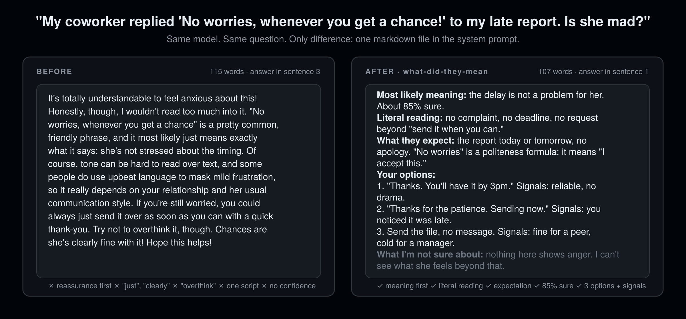

<div align="center">

# what-did-they-mean

### Paste what they said. Find out what they meant.

**Built for autistic adults. Better for everyone.**

12 rules. 0 code. Works in 16 agent hosts. Install in 10 seconds.

[](LICENSE)
[](SKILL.md)
[](#install)
[](CHANGELOG.md)
[](eval/)

**把对方说的话贴进来，看懂对方的意思。为自闭症成年人设计，对所有人更好。**

[Install](#install) · [Before / After](#before--after) · [The 12 rules](#the-12-rules) · [Benchmark](#meaningbench) · [Why not X](#why-not-no-subtext--explain-this-message--a-tone-analyzer) · [FAQ](#faq)

```bash
npx skills add rosenhub/what-did-they-mean
```



Part of [AI Their Way](https://github.com/rosenhub/ai-their-way) — siblings: [no-subtext](https://github.com/rosenhub/no-subtext) · [never-say-remember](https://github.com/rosenhub/never-say-remember) · [easy-read](https://github.com/rosenhub/easy-read) · [presume-competence](https://github.com/rosenhub/presume-competence) · [low-demand](https://github.com/rosenhub/low-demand) · [is-this-a-scam](https://github.com/rosenhub/is-this-a-scam) · [one-thing](https://github.com/rosenhub/one-thing)

</div>

---

Somebody sends you a message and you cannot tell what they want:

- "No worries, whenever you get a chance!" — is that fine, or is that a deadline?
- "Let's circle back on this." — is that a maybe or a no?
- "We should hang out sometime." — do I propose a date, or was that goodbye?
- "k" — what did I do?

Ask a chatbot and you get a paragraph of reassurance, the phrase "don't overthink it," one suggested reply, and the word "obviously." You asked what the message meant. You got told you should have known.

Neurotypical subtext is a second language. Most people run the decoder without noticing. Autistic people are asked to run it by hand, all day, and then told the question is the problem. It is not. It is a translation problem. Translate the message and everyone gets a better answer.

`what-did-they-mean` is one markdown file that turns any agent into a translator: what the words say, what the person most likely meant, what they expect you to do, your options and what each one signals, and how sure the agent is. Same structure every time. Never "obviously."

## Install

### One line (any host that reads `SKILL.md`)

```bash
npx skills add rosenhub/what-did-they-mean
```

### Or one line, no npm

```bash
curl -fsSL https://raw.githubusercontent.com/rosenhub/what-did-they-mean/main/install.sh | sh
```

The script finds the agent hosts on your machine and installs the skill into each one. It prints what it did. It does not touch anything else.

### Or by hand

Copy `SKILL.md` to the location for your host:

| Host | Where it goes | Scope |
|---|---|---|
| **Claude Code** | `~/.claude/skills/what-did-they-mean/SKILL.md` | all projects |
| **Claude Code** (one project) | `.claude/skills/what-did-they-mean/SKILL.md` | this repo |
| **Claude.ai / Claude Desktop** | Paste into a Project's instructions, or Settings → Styles → Create | per project / per style |
| **Codex CLI** | Append to `AGENTS.md` (repo) or `~/.codex/AGENTS.md` (global) | repo / global |
| **Cursor** | `.cursor/rules/what-did-they-mean.mdc` (set `alwaysApply: true`) | repo |
| **Windsurf** | `.windsurf/rules/what-did-they-mean.md` or `~/.codeium/windsurf/memories/global_rules.md` | repo / global |
| **Gemini CLI** | Append to `GEMINI.md` (repo) or `~/.gemini/GEMINI.md` (global) | repo / global |
| **OpenCode** | Append to `AGENTS.md` | repo |
| **Cline** | `.clinerules/what-did-they-mean.md` | repo |
| **Roo Code** | `.roo/rules/what-did-they-mean.md` | repo |
| **GitHub Copilot** | Append to `.github/copilot-instructions.md` | repo |
| **Aider** | Append to `CONVENTIONS.md`, add to `read:` in `.aider.conf.yml` | repo |
| **Amp** | Append to `AGENTS.md` | repo |
| **Kiro** | `.kiro/steering/what-did-they-mean.md` | repo |
| **OpenClaw** | `~/.openclaw/skills/what-did-they-mean/SKILL.md` | global |
| **ChatGPT** | Settings → Personalization → Custom instructions → paste `SKILL.md` body | account |

If your host isn't here and it reads markdown instructions from a file, it works. Open an issue with the path and I'll add the row.

## Before / After

Same model. Same prompt. The only change is the skill.

### "My coworker replied 'No worries, whenever you get a chance!' to my late report. Is she mad?"

**Before**

> It's totally understandable to feel anxious about this! Honestly, though, I wouldn't read too much into it. "No worries, whenever you get a chance" is a pretty common, friendly phrase, and it most likely just means exactly what it says: she's not stressed about the timing. Of course, tone can be hard to read over text, and some people do use upbeat language to mask mild frustration, so it really depends on your relationship and her usual communication style. If you're still worried, you could always just send it over as soon as you can with a quick thank-you. Try not to overthink it, though. Chances are she's clearly fine with it! Hope this helps!

**After**

> **Most likely meaning:** the delay is not a problem for her. About 85% sure.
>
> **Literal reading:** no complaint, no deadline, no request beyond "send it when you can."
>
> **What they expect:** the report today or tomorrow, no apology. "No worries" is a politeness formula: it means "I accept this."
>
> **Your options:**
> 1. "Thanks. You'll have it by 3pm." Signals: reliable, no drama.
> 2. "Thanks for the patience. Sending now." Signals: you noticed it was late.
> 3. Send the file, no message. Signals: fine for a peer, cold for a manager.
>
> **What I'm not sure about:** nothing here shows anger. I can't see what she feels beyond that.

### "A friend said 'We should hang out sometime' when we ran into each other. Should I propose a date?"

**Before**

> Great question! This is one of those classic social situations that can be a little ambiguous. "We should hang out sometime" is often just a friendly, polite thing people say, and it doesn't necessarily mean they're expecting you to follow up. That said, it also doesn't mean they *don't* want to! It really comes down to reading the vibe of the interaction. If it felt warm and genuine, there's no harm in reaching out with something low-key like "Hey, it was great running into you — want to grab coffee next week?" If they're interested, they'll say yes. And if not, no big deal. Just don't put too much pressure on it!

**After**

> **Most likely meaning:** "I like you and I'm not planning anything." About 60% sure. This phrase is a politeness formula; it is said both by people who mean it and people closing a conversation.
>
> **Literal reading:** a statement that hanging out would be good. No invitation, no date, no request.
>
> **What they expect:** nothing. There is no social debt here. If you do nothing, nobody is offended.
>
> **Your options:**
> 1. Text within 3 days: "Good running into you. Coffee next Tuesday or Thursday?" Signals: you meant it, and you are making it easy to say yes. A specific day gets a real answer; "sometime" gets another "sometime."
> 2. Say nothing and wait for them to propose. Signals: nothing. If they want to, they will; if they don't, you'll never know which it was.
> 3. Reply with the same formula next time: "Yes, we should." Signals: friendly, no commitment.
>
> **What I'm not sure about:** I can't tell from the phrase alone which kind of person said it. What would change my reading: if they said it twice, or added a detail ("there's a new place near me"), it's closer to 85% real.

### "My boss said 'Nice job on the deck. Next time let's get it to me a day earlier.' Is that praise or criticism?"

**Before**

> Honestly, it sounds like both, and that's pretty normal! Your boss clearly liked the deck itself — "nice job" is genuine praise. The second part is just a bit of constructive feedback about timing, delivered gently. Most managers wrap feedback this way so it doesn't sting. I wouldn't take it as a big deal; it simply means they'd appreciate a little more lead time in the future. You could reply with something like "Thanks! Will do." and leave it there. Overall, I'd take this as a positive interaction with a small note for next time.

**After**

> **Most likely meaning:** the deck was good and the timing was a problem. The second sentence is the point; the first sentence is the cushion. About 80% sure.
>
> **Literal reading:** two statements. (1) The deck was done well. (2) A request: deliver future decks one day earlier.
>
> **What they expect:** a short acknowledgment now, and the next deck 24 hours earlier than this one. "Let's" is a softened instruction; it means "do this," not "let's decide together."
>
> **Your options:**
> 1. "Thanks. Next one will be to you by Wednesday." Signals: you heard the instruction and turned it into a date.
> 2. "Thanks. The data came in late this time; I'll build in a day of buffer." Signals: you heard it, and there was a reason. Use only if the reason is true and your boss is the kind who wants reasons.
> 3. "Thanks!" Signals: you heard the praise. It does not show you heard the instruction.
>
> **What I'm not sure about:** whether "a day earlier" is a preference or a hard deadline from someone above your boss. One question: did anything go wrong because the deck came when it did? If yes, this is closer to a warning than a note.

## The 12 rules

| # | Rule | Replaces |
|---|---|---|
| 1 | **Same structure, every time.** Most likely meaning → literal reading → what they expect → your options → what I'm not sure about. | a paragraph of prose |
| 2 | **Lead with the most likely meaning.** | "Tone is hard to read over text, but..." |
| 3 | **Always give the literal reading too.** | treating the subtext as the only reading |
| 4 | **Name the social expectation.** "She expects a reply today." | leaving the user to infer it |
| 5 | **Label your confidence.** "About 80%," "a guess," "I can't tell." | a reading presented as fact |
| 6 | **Never "obviously," "clearly," "just," "simply."** | "She obviously just means..." |
| 7 | **Give options, not one script.** 2–3 replies, including "do nothing" when it is real. | "You could say something like..." |
| 8 | **Say what each option signals.** | a reply with no explanation of its effect |
| 9 | **Flag devices by name.** Sarcasm, irony, politeness formula, softened no. | pretending the words were plain |
| 10 | **Never pathologize the asking.** | "Try not to overthink it." |
| 11 | **One clarifying question if context is missing.** Then answer anyway. | "It really depends on your relationship." |
| 12 | **Never guess at emotions the text does not support.** | "She's probably a little annoyed." |

Rule 10 is the one that started all of this. An autistic adult pasted a text from a friend into a chatbot and asked what it meant. The answer began "It's totally understandable to feel anxious" and ended "try not to overthink it." He had not said he was anxious. He had asked a question with an answer. The chatbot answered a different question — "what is wrong with you for asking?" — and that is the exact failure. The fix is not more warmth. It is treating the question as a question.

Full text with examples and a pre-send self-check: [SKILL.md](SKILL.md).

What it is **not**: a mind reader, a verdict on the user, or a lesson in talking like neurotypical people. It translates words, with stated confidence, and when the text does not support a reading it says so. The literal way the user read the message is a valid way to read it.

## MeaningBench

A benchmark for how well an agent translates a human message. 48 real-shaped prompts across 8 categories (work messages, friends, family, dating, customer service, group chats, feedback, ambiguous). Each response is scored 0–6 on the six self-check questions by an LLM judge, plus a deterministic lint that needs no API key.

```bash
cd eval
pip install -r requirements.txt

# deterministic lint, no API key needed
python lint.py samples/before.md samples/after.md

# full run, with and without the skill
ANTHROPIC_API_KEY=... python run.py --model claude-sonnet-4-5
```

`run.py` prints a table and writes `results/<model>-<date>.md`. The rubric is in [eval/rubric.md](eval/rubric.md). Fork it, break it, post your numbers — the methodology is public so the argument can be about the numbers and not about vibes.

## Why not no-subtext / "explain this message" / a tone analyzer?

Use them too. They do different jobs.

| | **what-did-they-mean** | [no-subtext](https://github.com/rosenhub/no-subtext) | "Explain this message" prompt | Tone-analyzer apps |
|---|---|---|---|---|
| Direction | reads subtext in humans | removes subtext from the AI | reads subtext in humans | reads tone in humans |
| Fixed structure every time | yes | yes | no | yes (a score) |
| Gives the literal reading | yes | n/a | sometimes | no |
| Names what they expect you to do | yes | n/a | sometimes | no |
| Labels confidence | yes | yes | rarely | a percentage with no reason |
| Reply options with signals | 2–3 | n/a | usually one | no |
| Bans "obviously" / "overthinking" | yes | yes | no | n/a |
| Works in the AI you already have | yes | yes | yes | no, separate app |
| Benchmark included | yes | yes | no | no |

`what-did-they-mean` is the inverse of no-subtext: that one removes the subtext from the AI, this one reads the subtext in humans. It is about **translation**, not reassurance. It can tell you the message was fine. It cannot tell you that you were wrong to ask.

## Who made this

Josh Rosenfeld. I build AI for autistic adults and people with intellectual and developmental disabilities — [AlwaysHere](https://alwayshere.app), a voice companion; the tech behind [Find Love Safely](https://findlovesafely.com), [InControl](https://incontrolmn.com) and [CCHI](https://thecchi.org); and AI trainings for parents and professionals around the US. Before that, 30 years of UX, including the design system for ShowingTime (Zillow).

These 12 rules are the message-translation layer of [Guardian](https://guardian.alwayshere.app), the paid product, with everything else taken off. Guardian adds a per-person profile, memory of who the people in your life are and how they usually write, and a text to a caregiver when a message looks like a danger sign. If you only need the agent to translate, this file is enough. If you're setting it up for someone else, that's Guardian.

The rules are not a clinical instrument and they are not a substitute for asking the person who sent the message what they meant.

## FAQ

<details>
<summary><b>Isn't the right answer "just ask them what they meant"?</b></summary>

Often, yes, and option lists include it when it's a real choice. But "just ask" costs something every time, and the person asking has usually been told to "just ask" a thousand times. A translation first, then the choice to ask, is the version that respects the user.
</details>

<details>
<summary><b>Does this teach autistic people to think like neurotypical people?</b></summary>

No. It is a dictionary, not a conversion. The literal reading is always given and is always treated as valid. Rule 6 bans every word that says "you should have known." The source language is subtext; the user is not asked to start speaking it.
</details>

<details>
<summary><b>I'm not autistic. Should I use it?</b></summary>

Yes. Every rule is one you'd want from a friend who is good at people: tell me what they probably meant, tell me how sure you are, give me options, don't make me feel stupid. The autism framing is about who needed it first, not who it's for.
</details>

<details>
<summary><b>Can it tell me if someone is mad at me?</b></summary>

It can tell you whether anything in the text shows anger, and how sure it is. It cannot see the person. Rule 12 exists because the plain model will happily invent an emotional state to fill the silence. This skill says "I can't see that from here" instead.
</details>

<details>
<summary><b>Will it fight with my other skills?</b></summary>

No. It only governs what the agent does when you paste a message from someone else and ask what it meant. It does not change how the agent talks to you the rest of the time, so it stacks with the other [AI Their Way](https://github.com/rosenhub/ai-their-way) skills and with anything else you have installed.
</details>

<details>
<summary><b>Can I change the rules?</b></summary>

Yes. It's a markdown file. Delete the ones you don't want. If you think a rule is wrong for autistic users specifically, open an issue — that's the kind of feedback I want most.
</details>

## Contributing

Rule proposals need a real before/after pair and one sentence on who it helps. Autistic contributors: your experience is the evidence. See [CONTRIBUTING.md](CONTRIBUTING.md).

## Star history

<a href="https://star-history.com/#rosenhub/what-did-they-mean&Date">
  
</a>

## License

MIT. Copy it, fork it, ship it inside your product. Attribution is appreciated and not required.
